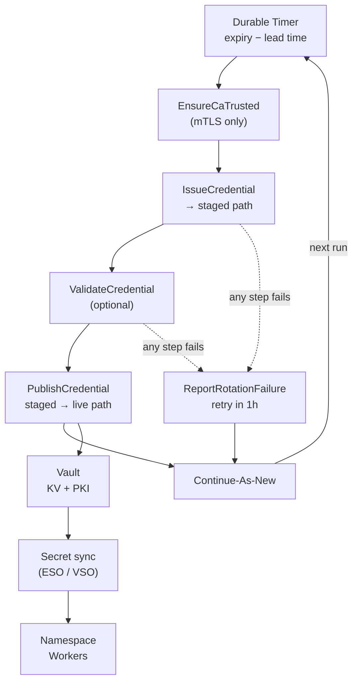

Every Temporal Cloud API key expires. Every mTLS certificate expires. And the way a lot of teams keep track of that is some combination of a spreadsheet, a calendar reminder, and the expiry email that lands in someone's inbox while they're on vacation.

When a renewal gets missed, every Worker on that Namespace loses its connection and Workflows stop making progress. When a renewal gets *rushed*, you can push a credential to Workers before Temporal Cloud has accepted it, and get the exact same outage. Either way, the risk scales with the number of Namespaces you run.

I've been writing this up as a full validated pattern (with runnable samples in Go, Python, TypeScript, Java, .NET, Ruby, and Rust), and this post is the condensed version: the shape of the solution, and the handful of decisions that make it safe.

---

# Why Not Just Use Cron?

Credential rotation looks like a scheduled job, but it's really a long-running, stateful problem. A credential issued today might not need attention for 30 or 90 days, and every Namespace has its own clock.

A cron job or a scheduled Lambda doesn't hold state between runs, so you'd need a database to track each Namespace's expiry, plus logic to decide which ones are due, plus retry handling, plus a way to see what happened last time. At that point you've built a worse workflow engine.

This is what the **entity Workflow** pattern is for. You dedicate one Workflow Execution to one thing (here, one Namespace's Worker credential) and give it a Workflow ID derived from that thing's name. Temporal persists the state, so the Workflow can sleep on a durable Timer for weeks without using any compute, then wake up exactly when it needs to. Worker restarts and deploys don't matter.

---

# The Shape of It

One Workflow per Namespace, with the ID `credential-rotation:<namespace>`. Each run does one thing: wait until the credential is close to expiry, try to rotate it once, then Continue-As-New.



The defaults are: rotate 7 days before expiry, issue credentials that last 30 days, retry a failed attempt after 1 hour. Operators can override any of those per Namespace with a Signal.

The whole wait-or-wake step is a Timer raced against two Signals:

```go
now := workflow.Now(ctx)
if rotateAt := nextRotationAt(in, now); rotateAt.After(now) {
	timerCtx, cancelTimer := workflow.WithCancel(ctx)
	timer := workflow.NewTimer(timerCtx, rotateAt.Sub(now))

	selector := workflow.NewSelector(ctx)
	selector.AddFuture(timer, func(workflow.Future) {})
	selector.AddReceive(rotateNow, func(c workflow.ReceiveChannel, _ bool) {
		c.Receive(ctx, nil)
	})
	selector.AddReceive(updateSettings, func(c workflow.ReceiveChannel, _ bool) {
		// replace settings, maybe Continue-As-New with the new rotation time
	})
	selector.Select(ctx)
	cancelTimer()
}
```

And deciding *when* to rotate is three lines of logic:

```go
func nextRotationAt(in RotationInput, now time.Time) time.Time {
	switch {
	case in.NextAttemptAt != nil: // a failed attempt scheduled a retry
		return *in.NextAttemptAt
	case in.Current.ExpiresAt.IsZero(): // newly enrolled, expiry unknown
		return now
	default:
		return in.Current.ExpiresAt.Add(-in.Settings.RotateBefore)
	}
}
```

Every run ends with Continue-As-New, success or failure. The Workflow never fails on its own, and Event History stays tiny no matter how many years the Namespace lives.

---

# Five Decisions That Make It Safe

The Workflow itself is small. What makes the pattern worth writing up is the handful of choices around it.

## 1. Never delete the old credential

Temporal Cloud lets more than one credential be valid at once: a Service Account can hold several unexpired API keys, and a Namespace can trust several CAs. The pattern leans on that overlap. It **adds** the new credential while the old one is still valid and never revokes anything. The old credential just expires on its own schedule.

That means there's no moment where every Worker has to switch at once. A Worker that's slow to reload keeps working on the old credential until it catches up.

## 2. Keep secrets out of Event History

Temporal stores Activity inputs and results in Event History. If `IssueCredential` returned a fresh API key, that key would now live in your Workflow history forever.

So the Activities only ever pass **paths and metadata** back to the Workflow. `IssueCredential` writes the token or private key straight to a staged path in Vault (`temporal/<namespace>/staged/<rotation-id>`) and returns the credential ID, expiry, and that path. The secret exists only inside the Activity and in Vault.

## 3. Prove it works before any Worker sees it

Temporal Cloud can take a few minutes to accept a new API key. If a Worker picked it up before then, it'd fail to connect. So between issuing and publishing there's an optional `ValidateCredential` step that builds a client with the *staged* credential and calls `DescribeNamespace`.

The trick is in the retry policy: validation has **no attempt limit**, just a 5-minute Schedule-To-Close Timeout. Temporal keeps retrying until Cloud accepts the credential or the window closes. If validation fails, `PublishCredential` never runs, and the unverified credential never reaches Workers.

For Namespaces where Workers need to start Workflows, there's also an opt-in write probe that spins up a throwaway Worker on a per-rotation Task Queue and runs one tiny Workflow. A read-only check can pass even when the credential lacks write permission, so it's worth deciding per Namespace which checks you actually need.

## 4. Roll CAs forward before leaf certificates

mTLS has two rotations hiding in it. The leaf certificate each Worker presents is short-lived and cheap to renew. The CA certificate changes rarely, maybe yearly. But when your PKI starts issuing from a new CA, the Namespace has to trust that CA *before* any leaf signed by it can connect.

So for mTLS, every rotation starts with `EnsureCaTrusted`. It compares the PKI's current CA against the Namespace's accepted bundle by SHA-256 fingerprint. Usually it's already there and the Activity is a no-op. When it isn't, the Activity keeps every still-valid CA, drops expired ones, appends the new one, and calls `UpdateNamespace` with the `ResourceVersion` it just read, so a concurrent change gets rejected and retried instead of clobbered.

(If Terraform manages your Namespace, decide who owns that CA bundle. Otherwise the next `terraform apply` can quietly remove the CA the Workflow just added.)

## 5. Failures go to a human, then retry

Any step that fails after its retries sends a JSON report to a webhook (your incident or ticketing system) with the Namespace, the failed step, the error, and, most importantly, when the *current* credential expires. Whoever picks it up knows exactly how much runway they have. Then the Workflow schedules another attempt in an hour and continues as new.

If the alert webhook itself is down, the Workflow logs it and moves on. An alerting problem should never take down the rotation.

---

# The Fun Edge Case

The Cloud Ops API shows an API key token exactly once, in the `CreateApiKey` response. So what happens if the Worker crashes *after* Cloud creates the key but *before* the Activity writes it to Vault?

Nobody can read that token again, and the Activity's retry creates a second key. That's fine: the orphaned key is never used and expires on its own. But a Service Account can only hold 20 unexpired keys, so keep credential lifetimes short enough that the occasional orphan never adds up to that limit.

I like this one because it's a good example of the pattern's general philosophy: rather than trying to make a non-idempotent external call idempotent, make the failure mode harmless.

---

# Enrolling and Operating

Enrollment is just starting the Workflow with `WorkflowIDConflictPolicy = USE_EXISTING`:

```go
run, err := c.ExecuteWorkflow(ctx, client.StartWorkflowOptions{
	ID:                       rotation.WorkflowID(in.Namespace), // credential-rotation:<namespace>
	TaskQueue:                rotation.TaskQueue,
	WorkflowIDConflictPolicy: enumspb.WORKFLOW_ID_CONFLICT_POLICY_USE_EXISTING,
}, rotation.CredentialRotationWorkflow, in)
```

That makes it safe to run from a pipeline every time you create a Namespace. If the Workflow already exists, you just get the running one back.

Day-to-day, it's all Queries and Signals:

```bash
# What's the current credential, when's the next rotation, how did the last one go?
temporal workflow query --workflow-id credential-rotation:payments.a1b2c --name status

# Suspect a leak? Rotate right now.
temporal workflow signal --workflow-id credential-rotation:payments.a1b2c --name rotate-now
```

A few operational notes worth calling out:

- **Run the rotation Workers in a different Namespace** from the ones they manage. You don't want a credential problem on a managed Namespace to take out the thing that fixes credential problems.
- **The Workflow's job ends at the key store.** Delivery to Workers is External Secrets Operator or Vault Secrets Operator's job. Mount the secret as **files**, not env vars: Kubernetes updates mounted files when a Secret changes but never touches env vars in a running container. Then either reload the credential in-process (every SDK except Rust can swap the API key or mTLS cert on a live client) or trigger a rolling restart.
- **Add an independent backstop.** The Workflow reports its own failures, but it can't report anything if its Workers aren't running. Route Temporal Cloud's built-in expiry notifications somewhere on-call actually looks, and consider a scheduled check that alerts when any Namespace's `Current.ExpiresAt` is closer than the lead time.

---

# Testing a 30-Day Cycle in Under a Second

The Temporal test framework skips time while the Workflow waits on a Timer, so you can mock the Activities and test an entire rotation cycle instantly. The test I care about most makes `ValidateCredential` always fail and asserts:

- `PublishCredential` is **never** called
- `ReportRotationFailure` is called exactly once
- the run continues as new with the old credential still current and the next attempt one hour out

That's the core guarantee of the whole pattern in one test: an unverified credential never reaches a Worker, and somebody finds out.

---

# Wrap Up

| | By hand | Entity Workflow |
|---|---|---|
| **Tracking expiry** | Spreadsheet, calendar, inbox | Durable Timer per Namespace |
| **Bad credential on Workers** | Possible if you rush | Validated before publish |
| **Cutover** | Everyone at once | Old and new overlap |
| **CA rollover** | Separate manual process | Checked before every mTLS rotation |
| **Failures** | Discovered at outage time | Alert with time-to-expiry, auto-retry |
| **Audit trail** | Whoever remembers | Event History + `status` Query |

The thing I keep coming back to is how little code the Workflow actually is. Most of the value is in the boundaries: what crosses into Event History, what gets published when, and what's allowed to fail. Temporal handles the long sleep, the retries, and the bookkeeping; you just decide where the lines go.
