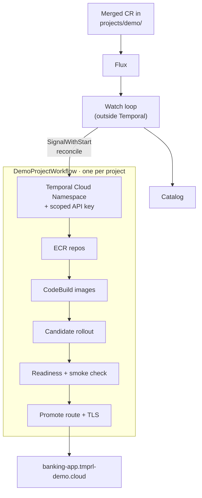
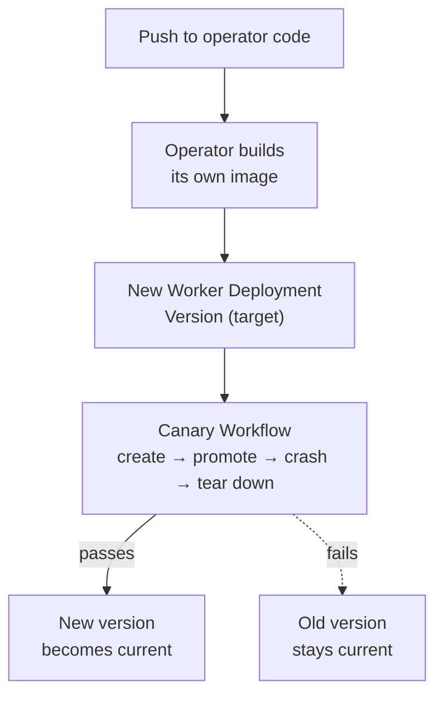

{/* TODO: hook. Swap in the real "before" story. Draft below is my guess at the shape; replace the specifics. */}

Here's how demos used to work. Someone builds a great one. It runs perfectly on their laptop against `temporal server start-dev`. It's in a repo with a README that says "run these six commands." And then, five minutes before a customer call, somebody else tries to run it and finds out their Python is the wrong version, the API key in their `.env` expired in August, and the Docker image doesn't build on Apple Silicon.

Workshops were their own flavor of the same problem. Every Instruqt track had a hand-built image, a hand-pushed track config, and a tribal-knowledge list of steps for publishing a fix.

So I built **tmprl-demo.cloud**: a catalog where a Solutions Architect adds **one YAML file** to a repo, opens a PR, and gets back a live demo at `<name>.tmprl-demo.cloud`. Or a published Instruqt workshop. Everything in between is automated, and every step of that automation is a Temporal Workflow.

{/* TODO: screenshot of the catalog home page */}

---

# What It Actually Does

A demo is one `DemoProject` custom resource. Here's the whole file for the banking money transfer demo, trimmed a bit:

```yaml
apiVersion: registry.tmprl-demo.cloud/v1alpha1
kind: DemoProject
metadata:
  name: banking-money-transfer
spec:
  registry:
    title: Banking Money Transfer
    tags: [Banking, Saga]
    temporalSdks: [Python]
  source:
    repo: https://github.com/temporal-sa/temporal-demo-banking-app-money-transfer
  builds:
    frontend: { context: ., dockerfile: docker/frontend.Dockerfile }
    backend:  { context: ., dockerfile: docker/backend.Dockerfile }
    worker:   { context: ., dockerfile: docker/worker-python.Dockerfile }
  components:
    frontend:
      build: frontend
      ports: [{ containerPort: 5173, servicePort: 80 }]
    backend:
      build: backend
      temporalAccess: true
      ports: [{ containerPort: 8000, servicePort: 8000 }]
    worker:
      build: worker
      worker: true
  ingress:
    subdomain: banking-app
  smokeCheck:
    path: /api/health
    expectedStatus: 200
```

Notice what's *not* in there: no Kubernetes namespace, no Temporal Cloud Namespace, no API key, no image tags, no ECR repo, no `TEMPORAL_ADDRESS`. The operator derives all of it from `metadata.name`. The author says *what* the demo is; the platform decides *where* it lives.

When that file merges, this happens with nobody touching anything:



Delete the file and it runs in reverse: Kubernetes namespace, Temporal Cloud API key, service account, Namespace, secrets, ECR repos, all gone, held behind a finalizer until the Workflow confirms the teardown.

Instruqt courses work the same way with an `InstruqtCourse` resource: the operator builds the course images, publishes them to public ECR, renders the track config with the right image references injected, and runs `instruqt track push`. Push a `live-test` branch to the course repo and you get a separate testing track. Delete the branch and the testing track goes away.

---

# Why Build the Operator on Temporal?

The obvious way to build this is a Kubernetes operator: a controller with a reconcile loop. I went with Temporal Workflows instead, and I'd make the same call again. The reconcile isn't really a Kubernetes problem. Most of the work happens *outside* the cluster, and most of it is slow:

- **CodeBuild runs take minutes.** A controller reconcile loop doesn't want to sit on a ten-minute build; you end up storing "build in progress, ID abc" somewhere and re-checking it on every pass.
- **Temporal Cloud is eventually consistent in ways that matter.** A new API key can take a few minutes before it's accepted. A new Namespace reports `ACTIVE` before its hostname resolves everywhere.
- **Failures need compensation.** If the build fails *after* I created a Temporal Cloud Namespace, a service account, a key, and three secrets, something has to clean those up, in the right order.
- **Some waits are measured in weeks.** Every runtime API key is a 30-day key, rotated 10 days before it expires.

Every one of those is "a long-running, stateful process that talks to flaky external systems." That's the thing Temporal is for. (If the key rotation part sounds familiar, it's the [entity Workflow pattern from my last post](/post/2026/rotate-temporal-cloud-credentials), just living inside a bigger Workflow.)


---

# The Shape of It

There's one long-lived **entity Workflow** per project, with the ID `demo-project/<name>`. It spends almost all of its life asleep, waiting for something to do: a new spec, a forced reconcile, a key rotation coming due, a finalize, or a new operator version.

```python
@workflow.run
async def run(self, request: DemoProjectRunRequest) -> None:
    self._apply_carried_state(request, request.project_name)

    while not self._shutdown:
        await self._wait_for_next_action()  # Signals, or a durable Timer for key rotation

        if self._finalize:
            await self._run_finalize(project_name)
            return

        if self._continue_as_new_for_worker_version:
            self._continue_as_new_if_needed(project_name)
            continue

        reconcile_input = await self._select_demo_project_for_reconcile(project_name)
        if await self._run_demo_project_reconcile(project_name, reconcile_input):
            self._complete_current_reconcile()
        self._continue_as_new_if_needed(project_name)
```

The actual reconcile is a pipeline of small Activities and a few Child Workflows (one for image builds, one for the Kubernetes runtime, one for AWS Lambda-backed serverless Workers). Each Activity is split along a retry boundary: `plan_external_resources`, `reconcile_ecr_repositories`, `reconcile_temporal_cloud_resource`, `start_project_image_build`, `wait_for_project_image_build`, and so on. If CodeBuild flakes, I retry the wait, not the ECR setup.

## The watch loop lives outside Temporal

What triggers the Workflow? A plain Python loop that lists `DemoProject` resources every 15 seconds. When a spec changes, it does a `SignalWithStart`:

```python
await temporal_client.start_workflow(
    DemoProjectWorkflow.run,
    args=[DemoProjectRunRequest(project_name=name)],
    id=demo_project_workflow_id(name, config.cluster),
    task_queue=config.task_queue,
    start_signal="reconcile",
    start_signal_args=[signal_arg],  # the full desired spec
)
```

Two decisions here that I'm happy with:

1. **The poller isn't a Workflow.** Polling Kubernetes every 15 seconds forever is not a durable-execution problem, and it'd burn Actions for nothing. The loop only signals when a spec's hash changes.
2. **The Signal is level-triggered.** It carries the *entire* desired spec, not "something changed." A missed Signal gets fixed on the next pass, and a duplicate is a no-op because the Workflow dedupes on a reconcile identity. That's the Kubernetes mindset, and it fits Temporal nicely.

---

# Lessons Learned (a.k.a. Things That Broke)

381 commits in four months. Not all of them were features. 😅 These are the ones that taught me something.

## 1. `SignalWithStart` and the Signal that vanished

The very first version had a bug where a brand-new project would just... hang. The Workflow was running, it had received the Signal, and it was sitting in `wait_condition` forever.

With `SignalWithStart`, the Signal is delivered on the **first Workflow Task**, so its handler can run before or alongside the start of `run()`. My `run()` started by restoring state carried over from Continue-As-New, and on a fresh start that state was `None`. So:

1. Signal handler sets `self._pending_spec = spec`
2. `run()` sets `self._pending_spec = request.carried_pending_spec` (which is `None`)
3. `wait_condition(lambda: self._pending_spec is not None)` waits forever

The fix is one `if`:

```python
# Only adopt a spec actually carried over from continue-as-new; a fresh
# SignalWithStart has already set it in the signal handler.
if request.carried_pending_spec is not None:
    self._pending_spec = request.carried_pending_spec
```

Lesson: with `SignalWithStart`, treat your Signal handler as part of initialization. Better yet, use `@workflow.init` and never assign handler-owned state in `run()`.

## 2. No patching. Ever. Worker Versioning instead.

The operator changes *constantly*. Early on I was using `workflow.patched()` to keep in-flight entity Workflows replay-safe, and it got ugly fast: a new patch for nearly every reconcile change, layered on top of each other, in Workflows that live for months.

So the operator moved to **Worker Versioning** with the [Temporal Worker Controller](https://github.com/temporalio/temporal-worker-controller) and **Pinned** Workflows. A running Workflow finishes on the code it started with. New code ships as a new Worker Deployment Version. And the patches all got deleted.

The catch with long-lived entity Workflows is that "finish on the version you started on" might mean "never." So each entity Workflow listens for a `check_worker_version` Signal and hops to the new version at a safe point:

```python
@workflow.signal
def check_worker_version(self, _signal: CheckWorkerVersionSignal) -> None:
    if workflow.info().is_target_worker_deployment_version_changed():
        self._continue_as_new_for_worker_version = True

# ...later, between reconciles
workflow.continue_as_new(
    args=[DemoProjectRunRequest(project_name=name, carried_status=..., ...)],
    initial_versioning_behavior=workflow.ContinueAsNewVersioningBehavior.AUTO_UPGRADE,
)
```

I got this wrong the first time. My original version did the upgrade *driven by the Signal itself* instead of through Continue-As-New, which meant the new version never got a clean history handoff. That defeats the whole point: the reason Continue-As-New is the upgrade path is that the new run starts with an empty Event History, so the new code never has to replay the old code's decisions.

## 3. The operator deploys itself

This is the part I'm proudest of, and the part that hurt the most.

The operator is a Temporal Worker. The registry web app and the operator's own Worker are just... another `DemoProject`. So when I push operator code, the operator builds its own next image, renders its own `WorkerDeployment`, and the Worker Controller rolls it out.

That's terrifying without a gate, so the gate is a **canary `DemoProject`**. Before the new operator version becomes current, it has to create a real demo end-to-end (Namespace, key, build, candidate, smoke check, promote), rotate its credentials, spin up and crash a disposable workspace, and then tear it all back down and *prove* the cleanup happened. If any of that fails, the old version stays current.



Getting there was a saga (heh). The first cutover to self-management got rolled back because the versioned Worker would never register its Worker Deployment Version with Temporal Cloud: `PermissionDenied`, `WaitingForPollers`, the rollout hung, and since the catalog web app was in the same project, the catalog went down with it. The root cause turned out to be my `requirements.txt` saying `temporalio>=1.29,<2` with no lockfile, so a rebuild quietly floated to a new SDK version. Then there were a couple of rounds of revert, reapply, revert-the-revert, and finally a cutover in a maintenance window.

Lesson: when the thing you're deploying is the thing that does the deploying, **pin everything**, and make sure there's a way to get back to a known-good image without the system's help.

## 4. Sagas, and the failures you can't see

Compensation went through two big rewrites, and both taught me something.

**Round one: first-time vs. established.** If a brand-new project fails halfway through, tear down everything this pass created. If an *established* project's new rollout fails, do the opposite: leave production alone, report `WorkerRolloutFailed`, and keep the entity Workflow alive. Simple enough. Except every established project kept getting classified as "first-time," because the reconcile Signal carried only the spec and stripped the status, and status was where "has an active version" lived. A failed rollout on the operator's *own* project failed its entity Workflow. Fun.

**Round two: stop swallowing errors.** My early Activities caught their own exceptions and returned `{"ok": False, "error": ...}`, and the Workflow orchestrated compensation off of that. It worked, but every failure was invisible in Event History. You'd open a Workflow in the UI and see a row of green, successful Activities and a status that said "failed." The fix was to let Activities **actually fail**, let the retry policy do its job, and run compensation in the saga when the failure finally surfaces. Now the red thing in the UI is the thing that broke.

{/* TODO: before/after screenshot of the Temporal UI for a failed reconcile, if you can dig one up */}

This is the same lesson as the credential rotation post, in a different costume: Event History is your debugger. Don't hide things from it.

## 5. The cloud is eventually consistent, and retry policies are the answer

A surprising amount of my commit history is variations of "wait for the thing that says it's ready to actually be ready":

- **New API keys** can take minutes before Temporal Cloud accepts them. The operator validates a staged key before any pod sees it.
- **New Namespaces** report `ACTIVE` before their gRPC host resolves. One rollout failed because the Worker Controller couldn't resolve the host for five minutes, timed out, and compensated away a perfectly good Namespace. There's now a `wait_for_temporal_cloud_namespace_dns` Activity that retries for up to 20 minutes (the `tmprl.cloud` negative DNS TTL is 15).
- **New IAM roles** for Lambda Workers can't be assumed for a few seconds after creation.
- **Lambda Worker Deployments** can't be deleted for five minutes after the last invocation, because Temporal remembers recent pollers.

Without Temporal, each of those is a hand-rolled `while not ready: sleep()` that dies when the process restarts. With Temporal, it's an Activity that raises a retryable error and a retry policy with a sensible schedule-to-close timeout. The difference is that the waiting is *durable*: a Worker deploy in the middle of a 20-minute DNS wait doesn't matter.

## 6. Make retries reattach, not repeat

CodeBuild builds are the most expensive thing the operator does. If the Worker restarts during a build, a naive retry starts a second build. Instead, `start_project_image_build` heartbeats the CodeBuild build ID, and on retry the Activity picks it back up from the heartbeat details and reattaches. Same trick for the Kubernetes Jobs that run the onboarding agent (more on that below): the Job name is derived from the run ID, so a retried Activity finds the Job that's already running.

## 7. Keep secrets out of Event History

I won't repeat the whole argument from the [credential rotation post](/post/2026/rotate-temporal-cloud-credentials), but it applies everywhere here. Temporal API keys go straight into AWS Secrets Manager inside the Activity, and the Workflow only ever sees paths and metadata. User-entered demo secrets go from the web server straight to Secrets Manager and never enter Temporal at all. LiteLLM keys minted for agent runs go into a Kubernetes Secret owned by the Job and are revoked when the run ends.

## 8. Some things Temporal can't fix

Not everything was a Workflow problem. For about a week, the operator Worker would occasionally wedge: the pod was `Running 1/1`, but its gRPC DNS resolver was stuck and it had stopped polling. Nothing in the reconcile path could fix it, because reconciling *requires* polling.

I tried `ndots:2`, NodeLocal DNSCache, periodic re-resolution, and a heartbeat file driven by `describe_namespace` behind a liveness probe. My best guess is that it's caused by the temporary Workers the canary spins up not shutting down cleanly. The commit message where I gave up and added the automatic pod restart back reads, in full, *"I'm very certain at this point it is being caused by the temporary worker not exiting cleanly, but whatever for now."* Honest engineering. 🙃

## 9. Don't let automation destroy what it can't prove

One rule I added later: if you remove an extra Temporal Namespace from a live project's spec, the operator does **not** delete it. It reports it as orphaned in status and waits for a human.

Deleting a Temporal Cloud Namespace destroys its history irreversibly, and the "is this orphaned?" check reads from status. A status patch that failed to land would be enough to delete a live Namespace. Full project teardown is fine, because that's an explicit, finalizer-held action. Inferring a deletion from a diff is not.

---

# What It Unlocked

This is the part that surprised me. Once every step was a durable Workflow, new features stopped being new infrastructure. They became *composition*: a new Workflow that calls the Activities and Workflows that already exist.

## Other people started shipping demos

{/* TODO: confirm counts and whether you want to name contributors */}

The catalog has **23 demos** and **6 Instruqt workshops** in it today, and a good chunk of them weren't added by me. Other SAs open a PR with one file, CI validates it against the schema and cross-file rules, and it's live a few minutes after merge. Nobody needs `kubectl` access. Nobody needs a Temporal Cloud admin key. Nobody needs to know what Flux is.

## Crashable workspaces

The best Temporal demo is killing a Worker in the middle of a Workflow and watching it pick up where it left off. That's hard to do on a shared demo without ruining it for everyone else.

So any signed-in user can now spin up a **crashable workspace**: a private, time-limited copy of a demo with its own Kubernetes namespace, hostname, and Task Queue, plus buttons to crash the Worker pods, scale them to zero, and bring them back. It's a `CrashableWorkspaceWorkflow` per user per demo, with a TTL on a durable Timer. When it expires, it batch-terminates any open Workflows from that workspace and deletes everything. There's a shareable guest link, so you can hand the customer the "crash" button yourself.

For Lambda-backed demos (where there's no pod to kill) there's an **isolated workspace** instead: a per-user copy with its own Lambda functions and Worker Deployment, reusing the demo's image and IAM roles.

## Workshops that publish themselves

Instruqt courses went from "remember the steps" to "merge to `main`." The `InstruqtCourseWorkflow` builds the images, publishes them, injects the image references, and pushes the track. A `live-test` branch gets you a testing track for free.

The catalog side brought along two companions:

- A **LiteLLM gateway and token broker**, so every learner in an AI workshop gets their own budget-capped, time-limited model key instead of a shared one.
- A small, KMS-signed **secret-broker CLI** that Instruqt setup scripts call to mint those keys inside the sandbox.

## Onboarding from the UI, with an agent

The newest piece: you don't have to write the YAML at all. In the catalog, "Add a Demo" starts a `CatalogOnboardingWorkflow` (one per user). You point it at a GitHub repo, and a Claude Agent SDK agent clones it into a locked-down Kubernetes Job (no service account token, no cloud credentials, egress firewall) and drafts the `DemoProject` for you. It explains each field, answers questions about a section, and suggests patches to the demo repo when something's hardcoded that shouldn't be.

The agent's output is a **proposal**. It always goes through the same validator CI uses, and the user applies it or ignores it. The agent never touches the draft directly.

Then there's an optional **48-hour test deploy**: an `OnboardingPreviewWorkflow` creates a hidden `pv-<name>` project, waits for it to promote, and tears it down on a durable Timer. Which, if you squint, is just the canary from lesson 3 with a friendlier UI. That's the composition thing I mean: the preview didn't need new provisioning code; it reused the canary's cleanup proof.

The hand-off is a pull request the user opens as themselves. Once it merges, the regular GitOps path takes over.

{/* TODO: screenshot or short GIF of the onboarding flow */}

## Demos that talk to each other

Projects can declare extra Temporal Namespaces and Nexus Endpoints, which means demos can call each other. My favorite example: the booth game we bring to events calls the event lead tracker demo over Nexus, so playing the game checks you into the event. Two demos, two Namespaces, one YAML change each.

---

# Still Learning

{/* TODO: anything you'd do differently from day one? A couple of candidates below. */}

A few things I'd tell myself on day one:

- **Start with Worker Versioning.** Patching a Workflow that lives for months is a trap. Pinned Workflows plus a Continue-As-New hop at a safe point is so much simpler.
- **Let Activities fail.** Returning error objects from Activities feels tidy and makes your Event History lie to you.
- **Split Activities on retry boundaries from the start.** I refactored the "one big reconcile Activity" into granular steps twice. Ask "what should be retried independently?" up front.
- **Pin your SDK and use a lockfile,** especially for anything that deploys itself.

---

# Wrap Up

| | Before | tmprl-demo.cloud |
|---|---|---|
| **Adding a demo** | README + six commands + luck | One YAML file in a PR |
| **Temporal credentials** | Long-lived keys in `.env` files | Per-demo Namespace, 30-day scoped key, auto-rotated |
| **Deploys** | Whoever has access | Candidate, smoke check, promote; failed candidates never take the route |
| **Teardown** | Mostly never | Delete the file; finalizer-held, ordered teardown |
| **Workshops** | Hand-built images, hand-pushed tracks | Merge to `main`; testing track per branch |
| **"Can I crash the Worker?"** | Not on the shared demo | Private crashable workspace, with a guest link |
| **Operator upgrades** | n/a | Self-built, canary-gated, Pinned Worker Versioning |

{/* TODO: sanity check the "Before" column against reality */}

The thing I keep noticing is how much of this platform is *waiting*. Waiting on builds, on DNS, on API keys, on rollouts, on 30-day timers, on a user to click "End preview." Temporal turned all of that waiting from something I had to babysit into something I could just write down. And once the waiting was solved, the interesting features (workspaces, previews, the onboarding agent) were mostly a matter of stitching together Workflows that already existed.
